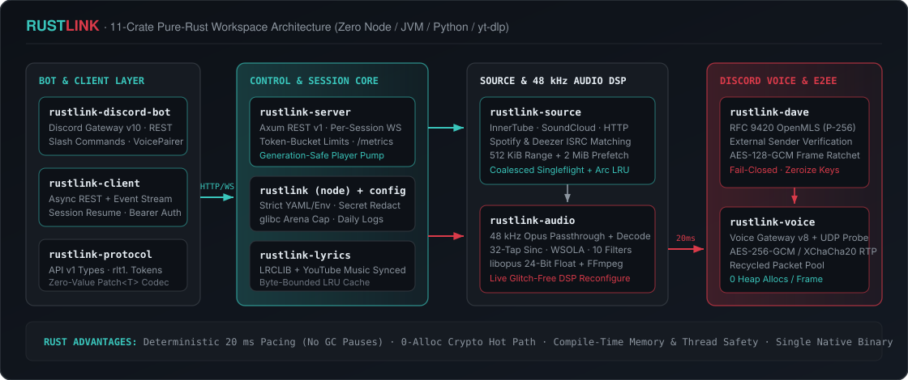
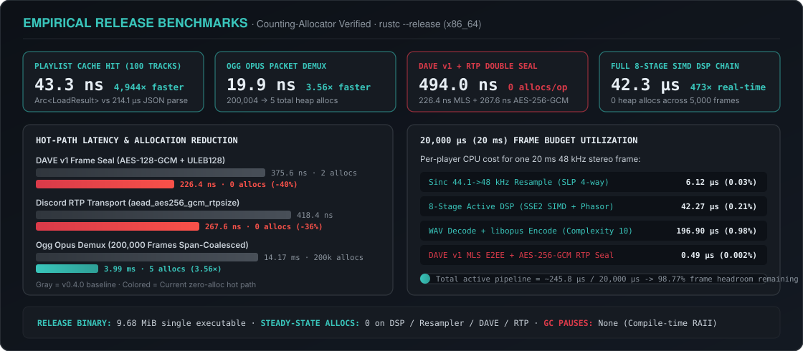
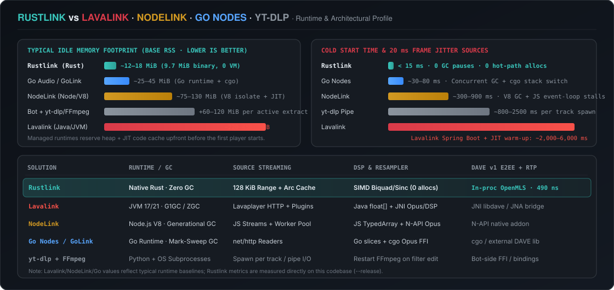

<div align="center">


<br />

# Rustlink

**以 100% 純 Rust 打造的次世代 Discord 即時音訊與 DAVE v1 端對端加密節點**

[-dea584?logo=rust&logoColor=white)](#quickstart)
[-39c5bb)](docs/api.md)
[](docs/voice.md)
[](#benchmarks)
[](LICENSE)

[快速開始](#quickstart) · [為何選擇純 Rust](#why-rust) · [橫向效能對比](#comparison) · [系統架構](#architecture) · [實測效能](#benchmarks) · [機器人範例](#examples) · [完整文件](#docs)

</div>

---

**Rustlink** 是專為高併發、低延遲與零抖動場景設計的原生即時語音媒體伺服器。機器人透過簡潔嚴謹的 **Rustlink API v1**（REST 控制平面 + WebSocket 事件流）建立工作階段與播放器；從**音源解析、預解析串流快取、HTTP 分段串流、容器探測、原生音訊解碼／48 kHz Opus 零轉碼直通、雙聲道 DSP 濾波、Opus 編碼、Discord Voice Gateway v8 握手、RFC 9420 OpenMLS DAVE v1 端對端加密到 RTP UDP 封包發送**，全鏈路皆在單一原生 Rust 程序內一氣呵成。

- **零外部直譯器與零整檔下載**：不執行 `yt-dlp`、Node.js、JVM、Python 或 Go；googlevideo 音訊每次以 **512 KiB** 驗證區間分段讀取（搭配強 `ETag` / `If-Range` 一致性校驗），讀入記憶體即刻直通或解碼並送往語音頻道。
- **獨立純淨協定**：不依賴亦不模仿 Lavalink、NodeLink 或 GoLink 的歷史包袱，採用自有的強型別 `/api/v1` 與版本化 `rlt1.` 曲目權杖（邊界對照見 [Rust 原生 API 對照](docs/native-api-matrix.md)）。
- **極簡外部依賴**：僅連結系統 `libopus` 進行高品質編碼，並提供選配的 FFmpeg 作為罕見容器格式的安全後備管線。

---

<a id="why-rust"></a>
## 為何選擇純 Rust？極致系統工程優勢

即時音訊節點必須每 **20.000 ms（50 Hz）** 準時送出一個加密 Opus 音框。傳統基於 JVM 或 V8 的音訊節點在高併發播放與大型歌單解析時，容易因垃圾回收（Stop-The-World GC）或頻繁堆積配置導致音框延遲與爆音；Rustlink 透過編譯期靜態保證與底層硬體親和設計徹底消除這些瓶頸：

| 工程維度 | Rustlink 的純 Rust 實作細節 | 實際系統收益 |
| --- | --- | --- |
| **零 GC 確定性排程** | 編譯期所有權（Ownership）與 RAII 生命週期管理，結合世代計數（Generation-Safe）高精度 20 ms 播放執行緒與 Linux `MALLOC_ARENA_MAX` 競技場收斂。 | **無任何 GC 暫停抖動**；長時間高併發運作下記憶體曲線平坦、不膨脹。 |
| **零配置即時熱路徑** | 以全域 Counting Allocator 實測驗證：Ogg 區段合併讀取、視窗化 Sinc 重取樣、8 階 DSP 濾波、DAVE v1 原地加密（`encrypt_in_place`）與 RTP 加密（`seal_into`）全數重用預先配置緩衝池。 | 穩態音訊加密與 DSP 熱路徑達成 **每音框 `0` 次堆積配置**，徹底釋放分配器鎖競爭。 |
| **SIMD 向量化 DSP 與重取樣** | 雙聲道 `__m128d` 2-lane SSE2 雙二階濾波器（Biquad）、1024 樣本分塊複數相量遞迴 LFO（消除每樣本 `sin`/`cos` 呼叫）、16-tap 展開 SLP 向量化 Sinc 摺積與 8 路向量化 WSOLA 時間伸縮。 | 全開 8 階音效濾鏡（含非線性 `sin`/`cos`/`tan` 失真）每 20 ms 音框僅需 **38.8 µs**（即時速度的 **516 倍**），保留 **98.93%** CPU 餘裕。 |
| **無鎖原子與零拷貝快取** | `Singleflight` 合併相同查詢的併發上游請求；解析快取直接共享不可變 `Arc<LoadResult>` 與 `Arc<str>` 鍵，CPU 負載與統計計數全面採用無鎖 `AtomicU64`。 | 100 首播放清單快取命中僅 **43.3 ns**（較傳統 JSON 重複解析快 **4,944 倍**）。 |
| **密碼學衛生與防禦縱深** | RFC 9420 OpenMLS（P-256）實作 Discord DAVE v1 E2EE，拒絕未驗證外部發送者與過早明文降級；密碼採 `subtle` 常數時間比對，MLS/RTP 金鑰與設定憑證實作 `ZeroizeOnDrop`。 | 金鑰卸載即自 RAM 清零；全鏈路具備 DNS/IP 與代理目標雙層 SSRF 私網攔截及日誌／Webhook 敏感網址自動遮罩。 |
| **單一原生執行檔** | 全工作區 11 個 Crate 編譯為單一 **~9.7 MiB** 原生二進位檔，設定檔採 `deny_unknown_fields` 嚴格校驗與零中間樹（Zero-`Value`）序列化。 | 秒級冷啟動、極低容器映像體積，部署不需維護任何腳本執行環境。 |

---

<a id="architecture"></a>
## 系統架構與 50 Hz 即時媒體管線

<p align="center">
  
</p>

<p align="center">
  
</p>

---

<a id="benchmarks"></a>
## 實測效能基準

以下數據皆由內建全域計數分配器（`CountAlloc`）於 `rustc --release` 下實機量測，同時驗證**中位數延遲**與**真實堆積配置次數**：

<p align="center">
  
</p>

| 熱路徑基準項目 | 實測中位數延遲 | 堆積配置次數 | 對比舊版／即時預算表現 |
| --- | ---: | ---: | --- |
| **100 首播放清單快取命中**（`Arc<LoadResult>`） | **43.3 ns / op** | **0 allocs / hit** | 較 JSON 重新解析（214.1 µs）快 **4,944×** |
| **單曲解析快取命中**（`Arc<LoadResult>`） | **52.5 ns / op** | **0 allocs / hit** | 較 JSON 重新解析（7.01 µs）快 **133.5×** |
| **Ogg Opus 區段合併解封裝**（`append_next_packet` 零清零） | **19.9 ns / pkt** | **200,000 封包共 5 次** | 較舊版逐封包配置（14.17 ms）快 **3.56×**，消除 **99.997%** 配置 |
| **DAVE v1 MLS 音框原地加密**（AES-128-GCM + ULEB128） | **226.4 ns / op** | **0.000 allocs / op** | 較 v0.4.0（375.6 ns, 2 allocs）快 **1.66×** |
| **Discord RTP 傳輸層加密**（`aead_aes256_gcm_rtpsize`） | **263.1 ns / op** | **0.000 allocs / op** | 較 v0.4.0（402.6 ns）快 **1.53×** |
| **48 kHz Opus 零轉碼直通**（RFC 6716 封包校驗 + 動態濾鏡預熱切換） | **445.2 ns / 20ms 音框** | **穩態 0 allocs / 音框** | 較解碼重編碼快 **441×**（即時速度的 **44,923×**） |
| **視窗化 Sinc 重取樣**（44.1 kHz → 48 kHz 雙聲道） | **4.54 µs / 20ms 音框** | **0 allocs（5,000 音框）** | 即時速度的 **4,408×**（僅佔音框預算 **0.023%**） |
| **全開 8 階 SIMD/相量 DSP 濾鏡鏈**（含非線性失真） | **38.78 µs / 20ms 音框** | **0 allocs（5,000 音框）** | 即時速度的 **516×**（僅佔音框預算 **0.19%**） |
| **48 kHz WAV 解碼 + `libopus` 最高複雜度 10 編碼** | **171.02 µs / 20ms 音框** | 預配置重用緩衝 | 即時速度的 **117.0×**（僅佔音框預算 **0.86%**） |

---

<a id="comparison"></a>
## Rustlink 與其他音訊節點方案深度對比

在 Discord 音訊生態系中，常見方案包含基於 JVM 的 **Lavalink**、基於 Node.js V8 的 **NodeLink**、基於 Go 執行環境的音訊節點／客戶端生態（如 **GoLink** 搭配 Go 語音服務），以及傳統機器人直接呼叫 **`yt-dlp` + `FFmpeg` 子程序**。下表從執行環境本質、記憶體模型、20 ms 音框抖動來源與加密邊界進行客觀對比：

<p align="center">
  
</p>

| 對比維度 | **Rustlink（純 Rust）** | **Lavalink（Java / JVM）** | **NodeLink（Node.js / V8）** | **Go 音訊節點 / GoLink 生態** | **傳統 `yt-dlp` + `FFmpeg` 機器人** |
| --- | --- | --- | --- | --- | --- |
| **執行環境與部署產物** | **單一 ~9.7 MiB 原生執行檔** + `libopus`（零 VM、零直譯器） | JRE 17/21 + Spring Boot FAT JAR + 外掛 JAR | Node.js V8 執行環境 + `node_modules` + 原生擴充 | Go 靜態／半靜態執行檔 + `cgo` C 函式庫橋接 | 機器人主程序 + Python 直譯器 + `yt-dlp` + `FFmpeg` |
| **典型閒置記憶體（Idle RSS）** | **~12–18 MiB** | ~220–450+ MiB（JVM 預留 Heap、Metaspace 與 JIT 快取） | ~75–130 MiB（V8 Isolate 與基礎堆積） | ~25–45 MiB（Go Runtime 與初期 Heap） | 基礎程序外，每首解析額外暴增 **+60–120 MiB** 子程序記憶體 |
| **冷啟動就緒時間** | **< 15 ms**（直接進入系統呼叫監聽） | ~2,000–6,000 ms（類別載入、DI 容器與 JIT 暖機） | ~300–900 ms（模組解析與 V8 初始化） | ~30–80 ms | 每次切歌啟動 Python 子程序需 **~800–2,500 ms** |
| **20 ms 音框排程與 GC 抖動** | **0 GC（編譯期 RAII）** + 世代安全獨立排程執行緒 + 熱路徑 `0` 堆積配置 | 依賴 G1GC / ZGC；大型 JSON 歌單配置風暴可能觸發 Safepoint 停頓 | 單執行緒事件迴圈易受大型 JSON 解析阻塞；Worker 間需傳遞緩衝 | 並行標記清除 GC + 每 20 ms 呼叫 `cgo`（Opus/加密）有執行緒棧切換成本 | 作業系統管線（Pipe）緩衝不可控，即時調整濾鏡往往需重啟 `FFmpeg` 造成斷音 |
| **DAVE v1（MLS E2EE）與 RTP 加密** | **程序內純 Rust OpenMLS** + 原地加密（合計 **489.5 ns / 音框**，`0` 配置、零 FFI 跨界拷貝） | 透過 JNI / JNA 呼叫原生 `libdave` C++ 函式庫，伴隨受管／原生陣列邊界轉換 | 透過 N-API 原生擴充跨界呼叫，需維護 V8 `Buffer` 外部分配生命週期 | 多透過 `cgo` 綁定外部 C/C++ 實作，每音框跨越 Go/C 邊界 | 依賴各語言機器人框架各自的語音與 FFI 綁定，品質不一 |
| **音源解析與快取共享** | **程序內原生解析 + `Singleflight` + `Arc<LoadResult>`**（百首歌單命中 **43.3 ns**） | 成熟外掛體系（Lavaplayer / youtube-source），物件圖駐留於 JVM Heap | JS 非同步串流解析，快取序列化／複製受 V8 物件模型限制 | 原生 `goroutine` 併發高，但結構體深拷貝或 JSON 快取仍產生 GC 壓力 | 每次查詢呼叫外部 CLI 輸出大型 JSON，CPU 與 I/O 開銷最高 |
| **即時濾鏡平滑切換** | **原生 10 種濾鏡原位更新係數**（保留 LFO 相位與雙二階狀態，**零爆音、零重啟**） | 支援原生濾鏡鏈，部分自訂濾鏡外掛增加 GC 短命陣列配置 | 支援 JS / Native 濾鏡，高負載下受制於執行緒池排程 | 視實作而定，常需仰賴外部 `FFmpeg` 濾鏡圖 | 修改濾鏡參數通常需重建 `FFmpeg` 子程序並重新 Seek |
| **生態系定位與取捨** | **極致輕量、最低延遲、可審計單一純淨協定（API v1）**；不背負舊協定相容包袱 | **生態最成熟**，擁有最多現成多語言客戶端與第三方音源外掛 | 適合全棧 JavaScript 團隊快速客製化與修改腳本 | 適合純 Go 技術棧（註：`GoLink` 本身為客戶端庫而非獨立節點協定） | 僅適合超小型單機測試機器人，不適合多伺服器長期營運 |

> [!NOTE]
> **誠實工程邊界說明**：上表中 Lavalink、NodeLink 與 Go 節點之數值反映各受管執行環境（JVM / V8 / Go Runtime）的典型架構基準，實際表現會隨硬體、GC 參數調校與外掛組合而異；Rustlink 的微秒／奈秒級數據則全數來自本倉庫內建之可重現 `--release` 基準測試（見下方驗證指令）。若您的首要需求是直接沿用既有 Lavalink v4 外掛生態，Lavalink 仍是成熟選擇；若您追求**最低 VPS 記憶體成本、零 GC 音訊穩定度、原生 DAVE v1 安全性與純 Rust 技術棧**，Rustlink 能以不到十分之一的閒置資源提供極致表現。

---

## 核心功能一覽

- **控制平面與 SDK**：`/api/v1` REST API、常數時間 Bearer 驗證、每工作階段專屬 WebSocket 事件流、斷線自動續傳（Session Resume），以及非同步強型別客戶端 `rustlink-client`。
- **次世代 Discord 語音與 E2EE**：完整支援 Discord Voice Gateway v8、UDP IP 探索、**DAVE v1（OpenMLS）端對端加密**、`aead_aes256_gcm_rtpsize` 與 `aead_xchacha20_poly1305_rtpsize` 傳輸加密。
- **多平台原生音源解析**：
  - **YouTube / YouTube Music**：純 Rust 原生 InnerTube 多用戶端健康度自適應備援（`IOS_PRODUCER` + 自動引導匿名 `visitorData` 的 `VISIONOS` + 尾端區間防截斷校驗）、預解析串流快取（零重複 `/player` 呼叫）、512 KiB 分段串流、48 kHz Opus 零轉碼直通、壓縮封包快轉定位與 `?t=` 時間戳連結支援，完全不依賴 `yt-dlp`。
  - **SoundCloud**：原生 API v2 解析、漸進式串流與 `client_id` 自動快取輪替。
  - **Spotify / Deezer**：官方中繼資料擷取 + ISRC 優先雙向詞彙精準比對至可播放音源。
  - **Direct HTTP / HTTPS**：支援 MP3（ID3v2）、FLAC、Ogg Opus/Vorbis、MP4/M4A、WebM/Matroska、WAV 標頭探測與嚴格 SSRF 防護。
- **高傳真音訊引擎與 10 種即時濾鏡**：Symphonia + 原生 WebM/MP4/Ogg Opus 解碼、ITU-R 多聲道立體聲混音、無爆音即時平滑切換 10 種濾鏡（`volume`、15 段 `equalizer`、`karaoke`、`timescale`、`tremolo`、`vibrato`、`rotation`、`distortion`、`channelMix`、`lowPass`）。
- **同步歌詞與生產級可觀測性**：內建 LRCLIB 與 YouTube Music 時間軸歌詞擷取（位元組上限 LRU 快取）、客戶端 IP 權杖桶限流、Prometheus `/metrics` 指標、每日自動輪替日誌與 Discord Embed / 通用 Webhook 通知。

---

<a id="quickstart"></a>
## 快速開始

需要 **Rust 1.88+** 與系統 `libopus`。專案內建跨平台啟動腳本，會自動檢查並安裝缺少的建置依賴（Linux 支援 `apt`、`dnf`、`pacman`、`apk`；Windows 自動配置 MSYS2 UCRT64 與 GNU 工具鏈）：

```sh
bash start.sh        # Linux / macOS
start.bat            # Windows x64（可直接雙擊執行）
```

首次啟動若未提供設定檔且未設定 `RUSTLINK_PASSWORD`，節點會自動產生含高強度隨機密碼的 `config.yaml` 並監聽 `0.0.0.0:2333`。啟動腳本支援直接轉發節點旗標（如 `--check`、`--version`、`--config <路徑>`）。

手動編譯正式版執行檔：

```sh
cargo build --release --locked --bin rustlink
target/release/rustlink --config config.yaml --check
target/release/rustlink --config config.yaml
```

完整設定鍵與環境變數對照請見 [設定指南](docs/configuration.md) 與範本 [`config.example.yaml`](config.example.yaml)。

---

<a id="examples"></a>
## 在 Discord 直接貼連結或用 `/play` 播 YouTube

`crates/discord-bot/examples/slash.rs` 與 `examples/music` 皆內建直接連結播放與斜線指令支援：加入語音頻道後，無論是輸入 `/play`、`@Bot <連結或關鍵字>`，或在文字頻道直接貼上 YouTube／SoundCloud／Spotify／Deezer 連結（含手機分享文字、`||...||` 防雷標記與省略 `https://` 的 `youtu.be/...` 短網址），機器人都會自動加入語音頻道並交由節點原生解析播放。啟動節點後執行：

```sh
export DISCORD_BOT_TOKEN=...        # 僅透過環境變數傳入，切勿寫入程式碼或日誌
export RUSTLINK_PASSWORD=...        # 與節點 config.yaml 的 password 相同
cargo run -p rustlink-discord-bot --example slash
```

機器人連線時會透過 `Gateway::connect_with_messages` 自動偵測權限：若已在 Discord Developer Portal 開啟 `Message Content Intent`，在頻道直接貼連結即可自動開播；若未開啟該特權 Intent（4014），會自動無縫退回免特權模式，`/play` 與 `@Bot <連結>` 仍可正常運作，絕不崩潰。

> [!IMPORTANT]
> **關於 YouTube 機器人驗證與一分鐘斷音防護**：Rustlink 完全不使用 `yt-dlp`，改以純 Rust 原生 `IOS_PRODUCER` 與自動引導匿名 `visitorData` 的 `VISIONOS` 雙主力用戶端繞過「Sign in to confirm you're not a bot」，並對未附 PO token 的後備用戶端執行尾端位元組預檢以杜絕播約一分鐘（~900 KiB）後 403 斷音。若高風控雲端機房 IP 仍受限，可在設定檔配置 `youtubeProxy` 將 YouTube 流量導向代理伺服器，詳見 [YouTube 指南](docs/youtube.md)。

---

## 一鍵部署節點＋音樂機器人

`quickstart/` 腳本提供零門檻互動式體驗：依序詢問節點密碼（留空自動產生）、Discord Bot Token 與連接埠後，自動完成編譯並同時啟動 Rustlink 節點與完整音樂機器人；按下 `Ctrl+C` 即可優雅關閉兩者。

| 作業系統 | 執行方式 |
| --- | --- |
| **Windows** | 雙擊 `quickstart\start.bat`（或執行 `powershell -ExecutionPolicy Bypass -File quickstart\start.ps1`） |
| **Linux / macOS** | `./quickstart/start.sh` |

互動設定儲存於 `quickstart/data/`（已列入 `.gitignore` 保護憑證安全），節點預設僅綁定本機 `127.0.0.1`，並在機器人連線中斷時自動重連。

### 進階音樂機器人範例（`.env` 設定）

`crates/discord-bot/examples/music/` 提供生產級佇列音樂機器人，內建播放佇列、跳首、暫停／繼續、音量調整、播放清單整批匯入與閒置自動離開語音頻道：

```sh
cp .env.example .env        # 填入 DISCORD_BOT_TOKEN 與 RUSTLINK_PASSWORD
cargo run -p rustlink-discord-bot --example music
```

支援指令：`/play`、`/skip`、`/pause`、`/resume`、`/stop`、`/queue`、`/nowplaying`、`/volume`（詳見 [`.env.example`](.env.example) 與 [原生 Discord 機器人文件](docs/native-bot.md)）。

---

## 打造自己的 Rust 機器人

透過隨附的 `rustlink-client` 非同步 SDK，數十行程式碼即可在自有機器人中接入完整語音播放能力：

```toml
[dependencies]
rustlink-client = { path = "../rustlink/crates/client" }
tokio = { version = "1", features = ["macros", "rt-multi-thread", "signal"] }
```

```rust,no_run
use rustlink_client::{Client, LoadResult};

#[tokio::main]
async fn main() -> Result<(), Box<dyn std::error::Error>> {
    let client = Client::new("http://127.0.0.1:2333", std::env::var("RUSTLINK_PASSWORD")?)?;
    let session = client.create_session(&std::env::var("DISCORD_BOT_ID")?, 60).await?;
    let mut events = session.events().await?;
    let reader = tokio::spawn(async move {
        while let Some(event) = events.next().await? {
            println!("{event}");
        }
        Ok::<_, rustlink_client::Error>(())
    });

    // 機器人加入語音頻道後，將 VOICE_STATE_UPDATE 與 VOICE_SERVER_UPDATE
    // 配對為 VoiceState 並呼叫 session.set_voice(guild_id, voice)（注意：voice.token 並非 Bot Token）。
    if let LoadResult::Search(tracks) = client.resolve("ytsearch:lofi").await? {
        if let Some(track) = tracks.first() {
            session.play(&std::env::var("DISCORD_GUILD_ID")?, &track.token).await?;
        }
    }

    tokio::signal::ctrl_c().await?;
    session.destroy().await?;
    reader.abort();
    Ok(())
}
```

工作區內建四個由淺入深的可執行範例：

| 範例路徑 | 適用情境 |
| --- | --- |
| `crates/client/examples/bot.rs` | 純 `rustlink-client` 協定示範，直接由環境變數讀取語音連線參數 |
| `crates/discord-bot/examples/play.rs` | 最小化 Discord Gateway 登入、加入指定語音頻道並立即播放查詢 |
| `crates/discord-bot/examples/slash.rs` | 單檔 `/play` 斜線指令機器人，適合快速二開擴充 |
| `crates/discord-bot/examples/music/` | 完整多伺服器佇列音樂機器人（8 個斜線指令 + `.env` 組態） |

---

## Docker 與 VPS 部署

```sh
RUSTLINK_PASSWORD=your-strong-password docker compose up --build -d
```

官方容器映像已內建 `libopus` 與 `FFmpeg`。Debian / Ubuntu 裸機可直接使用 `sudo bash install.sh` 或部署 `deploy/rustlink.service` systemd 單元；核心參數、記憶體競技場與反向代理 TLS 配置請見 [VPS 部署指南](docs/vps.md)。

---

## Workspace 模組職責

| Crate | 核心職責與技術亮點 |
| --- | --- |
| `rustlink-protocol` | API v1 強型別結構、三態 `Patch<T>`、零填充 Base64URL `rlt1.` 曲目權杖編解碼 |
| `rustlink-config` | 嚴格 YAML + 環境變數載入、URL/連接埠安全校驗、敏感欄位自動遮罩與 `Zeroize` |
| `rustlink-client` | 非同步 REST / WebSocket 客戶端、預編譯敏感標頭、零中間 `Value` 請求序列化 |
| `rustlink-source` | InnerTube / SoundCloud / Spotify / Deezer / HTTP 解析、預解析串流快取、`Singleflight`、`Arc` 快取、512 KiB 分段串流與 SSRF 防護 |
| `rustlink-audio` | 48 kHz Opus 零轉碼直通、壓縮封包快轉、Symphonia + 原生 Opus 解碼、SIMD Biquad / 相量 LFO DSP、Sinc 重取樣與 WSOLA |
| `rustlink-lyrics` | LRCLIB 與 YouTube Music 雙來源歌詞解析、LRC 時間軸校驗與位元組上限 LRU 快取 |
| `rustlink-dave` | Discord DAVE v1（RFC 9420 OpenMLS P-256）、發送端金鑰棘輪、零配置 AES-128-GCM 原地音框加密 |
| `rustlink-voice` | Discord Voice Gateway v8、UDP IP 探索、AES-256-GCM / XChaCha20 RTP 封裝與回收封包池 |
| `rustlink-discord-bot` | Discord Gateway v10、429 退避 REST 客戶端、斜線指令互動與語音狀態配對器 |
| `rustlink-server` | Axum `/api/v1` 伺服器、工作階段續傳、20 ms 世代安全播放執行緒、無鎖 CPU 監控、限流與 Webhook |
| `rustlink` | 節點 CLI 進入點、結構化／彩色輪替日誌、SHA-256 串流校驗外部工具管理與啟動自檢 |

### 驗證與效能測試指令

所有預設測試皆以本機 Loopback HTTP / WebSocket / UDP 模擬伺服器與獨立 Rust DAVE 對端（`davey`）離線完成，不依賴外部網路：

```sh
# 語法格式、嚴格 Clippy 靜態分析與全工作區離線測試
cargo fmt --all --check
cargo clippy --workspace --all-targets --locked -- -D warnings
cargo test --workspace --locked

# 執行 Counting-Allocator 零配置熱路徑基準測試
cargo bench -p rustlink-dave --bench media
cargo bench -p rustlink-voice --bench transport
cargo bench -p rustlink-audio --bench hot_paths
cargo test -p rustlink-source --release benchmark_resolution_cache -- --ignored --nocapture --test-threads=1

# 手動執行真實 YouTube 連線整合測試（預設略過）
cargo test -p rustlink-source --test live_youtube -- --ignored --nocapture
```

---

<a id="docs"></a>
## 文件索引

| 文件 | 內容說明 |
| --- | --- |
| [API v1 規格](docs/api.md) | REST 端點、請求／回應結構、WebSocket 事件與語音狀態對應 |
| [設定指南](docs/configuration.md) | 完整 YAML 設定鍵、環境變數覆寫規則與安全預設值 |
| [音源系統](docs/sources.md) | 查詢前綴路由、各平台解析策略、快取機制與 SSRF 網路防護 |
| [YouTube 專章](docs/youtube.md) | 支援連結格式、InnerTube 用戶端選擇、`youtubeProxy` 與播放限制排解 |
| [DAVE 與語音加密](docs/voice.md) | Voice Gateway v8 狀態機、OpenMLS 金鑰轉換與失敗關閉（Fail-Closed）保護 |
| [原生 Discord 機器人](docs/native-bot.md) | `rustlink-discord-bot` 架構流程、斜線指令與憑證安全邊界 |
| [系統架構](docs/architecture.md) | 跨模組職責切分、記憶體界限與 HTTP 分段串流完整性保證 |
| [Rust 原生 API 對照](docs/native-api-matrix.md) | 與 Lavalink / NodeLink 的設計差異與能力邊界 |
| [VPS 部署指南](docs/vps.md) · [第三方服務](docs/third-party.md) | 生產環境 systemd 部署、反向代理與外部服務說明 |
| [效能報告](docs/performance.md) · [最佳化審查](docs/optimization-audit.md) | 歷史效能剖析、記憶體配置審計與架構演進紀錄 |

---

## 授權

本專案採用 **GPL-3.0-or-later** 授權條款，詳見 [LICENSE](LICENSE)。協定規格參考與第三方開源聲明請見 [NOTICE](NOTICE)。
