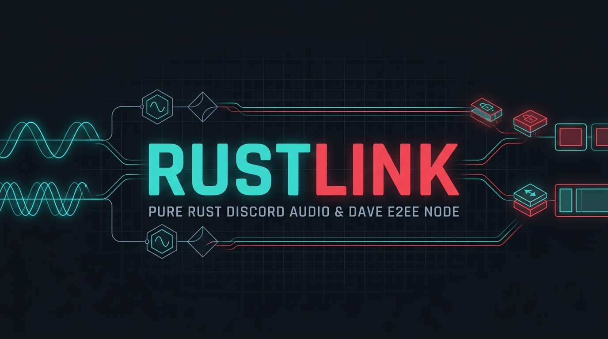
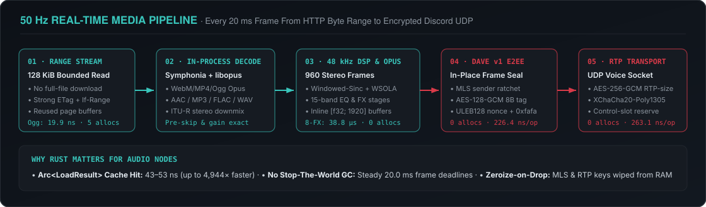

<div align="center">



<br />

# Rustlink

**100% 純 Rust 次世代 Discord 即時音訊與 DAVE v1 端對端加密節點**

[-dea584?logo=rust&logoColor=white)](#quickstart)
[-39c5bb)](docs/api.md)
[](docs/voice.md)
[](#benchmarks)
[](LICENSE)

[一鍵部署](#one-click) · [為何選擇純 Rust](#why-rust) · [系統架構](#architecture) · [實測效能](#benchmarks) · [機器人開發](#examples) · [文件索引](#docs)

</div>

---

**Rustlink** 是專為高併發、低延遲與零抖動設計的原生即時語音媒體伺服器。機器人透過強型別 **Rustlink API v1**（REST 控制平面 + WebSocket 事件流）驅動播放；從**音源解析、預解析串流快取、HTTP 分段串流、容器探測、原生音訊解碼／48 kHz Opus 零轉碼直通、雙聲道 DSP 濾波、Opus 編碼、Discord Voice Gateway v8 握手、RFC 9420 OpenMLS DAVE v1 端對端加密到 RTP UDP 發送**，全鏈路在單一原生 Rust 程序內完成。

- **零外部直譯器、零整檔下載**：不執行 `yt-dlp`、Node.js、JVM、Python 或 Go；googlevideo 以 **512 KiB** 驗證區間分段讀取（強 `ETag` / `If-Range` 校驗）搭配 **2 MiB** 背景預讀環形緩衝直通或解碼送出。
- **獨立純淨協定**：不背負 Lavalink、NodeLink 或 GoLink 的歷史相容包袱，採用自有 `/api/v1` 與版本化 `rlt1.` 曲目權杖（見 [Rust 原生 API 對照](docs/native-api-matrix.md)）。
- **極簡依賴**：僅連結系統 `libopus`，並提供選配 FFmpeg 作為罕見容器後備管線。

---

<a id="one-click"></a>
<a id="quickstart"></a>
## 一鍵部署（節點＋完整佇列音樂機器人）

支援本機 Windows / Linux / macOS、VPS systemd 與 Docker 三種一鍵部署，單次編譯同時產出音訊節點與完整佇列音樂機器人（支援 `/play`、`/skip`、`/pause`、`/resume`、`/stop`、`/queue`、`/nowplaying`、`/volume`、`@Bot <查詢>` 與頻道直接貼連結播放）：

| 部署場景 | 一鍵指令 | 行為說明 |
| --- | --- | --- |
| **Windows 本機** | 雙擊 `quickstart\start.bat`（或 `$env:DISCORD_BOT_TOKEN='...'; .\quickstart\start.ps1`） | 自動安裝缺少的 MSYS2 UCRT64 Rust / GCC / `libopus`，互動詢問（或直接讀取環境變數）寫入 `quickstart\data\`，同時啟動節點與機器人 |
| **Linux / macOS 本機** | `./quickstart/start.sh`（或 `DISCORD_BOT_TOKEN=... ./quickstart/start.sh`） | 自動安裝缺少的編譯工具鏈、`libopus`（`apt`/`dnf`/`pacman`/`apk`/`brew`）與 `rustup`，單次建置並啟動節點與機器人 |
| **Linux VPS（systemd）** | `sudo DISCORD_BOT_TOKEN=... ./install.sh --with-bot` | 自動建置安裝 `/opt/rustlink/{rustlink,rustlink-bot}`，寫入權限 `0640` 的 `config.yaml` 與 `bot.env`，啟用沙盒強化的 `rustlink` 與 `rustlink-bot` 雙服務 |
| **Docker Compose** | `RUSTLINK_PASSWORD=... DISCORD_BOT_TOKEN=... docker compose --profile bot up -d --build` | 單一映像同時打包 `rustlink` 與 `rustlink-bot`（內建 `libopus` 與 `FFmpeg`），唯讀檔案系統與零 Linux Capabilities 執行 |

### 僅啟動音訊節點（供自有機器人連線）

```sh
bash start.sh                           # Linux / macOS（自動安裝依賴並編譯啟動）
start.bat                               # Windows x64（雙擊或命令列執行，支援傳遞 --check / --version）
sudo ./install.sh                       # Linux VPS 僅部署 rustlink.service
RUSTLINK_PASSWORD=... docker compose up -d --build
```

首次啟動未指定設定檔且未設定 `RUSTLINK_PASSWORD` 時，節點會自動產生高強度隨機密碼寫入 `config.yaml` 並監聽 `0.0.0.0:2333`（完整選項見 [設定指南](docs/configuration.md) 與 [`config.example.yaml`](config.example.yaml)）。

---

<a id="why-rust"></a>
## 為何選擇純 Rust？

即時音訊節點必須每 **20.000 ms（50 Hz）** 準時送出加密 Opus 音框。Rustlink 以編譯期靜態保證與零配置熱路徑消除受管執行環境（JVM / V8 / Go）的 GC 停頓與配置抖動：

| 工程維度 | 純 Rust 實作細節 | 實際系統收益 |
| --- | --- | --- |
| **零 GC 確定性排程與背景預讀** | RAII 生命週期管理、2 MiB 背景預讀緩衝（`PrefetchReader`）、微秒級自旋對齊 20 ms 排程執行緒（Windows 1 ms 計時粒度 + 5 ms 緩步追幀）與 Linux `MALLOC_ARENA_MAX=2`。 | **零 GC 停頓、零網路續傳斷音**；長時間高併發運作記憶體曲線平坦。 |
| **零配置即時熱路徑** | 全域 `CountAlloc` 實測驗證：Ogg 區段合併讀取、Sinc 重取樣、8 階 DSP 濾波、DAVE v1 原地加密（`encrypt_in_place`）與 RTP 封裝（`seal_into`）全數重用預配置緩衝。 | 穩態音訊加密與 DSP 達成 **每音框 `0` 次堆積配置**，消除分配器鎖競爭。 |
| **SIMD DSP 與 24-Bit 浮點編碼** | `__m128d` SSE2 雙二階濾波器、1024 樣本分塊相量 LFO、32-tap 四階 Blackman-Harris（-92 dB 阻帶）Sinc 重取樣、8 路向量化 WSOLA 與 `opus_encode_float` + `opus_pcm_soft_clip`。 | 全開 8 階濾鏡每 20 ms 音框僅 **38.8 µs**（即時速度 **516×**），消除 16-bit 量化雜訊與大增益破音。 |
| **無鎖原子與零拷貝快取** | `Singleflight` 合併相同查詢請求；LRU 快取直接共享 `Arc<LoadResult>`，統計計數全面採用無鎖 `AtomicU64`。 | 100 首歌單快取命中僅 **43.3 ns**（較 JSON 重複解析快 **4,944×**）。 |
| **密碼學衛生與防禦縱深** | RFC 9420 OpenMLS（P-256）實作 DAVE v1 E2EE（Fail-Closed）、`subtle` 常數時間密碼比對、金鑰與憑證 `ZeroizeOnDrop`、雙層 SSRF 攔截與敏感網址遮罩。 | 金鑰卸載即自 RAM 清零，杜絕未授權降級與內網探測。 |
| **單一原生執行檔** | 11 個 Crate 編譯為單一 **~9.7 MiB** 執行檔，`deny_unknown_fields` 嚴格設定校驗與零中間 `Value` 序列化。 | `< 15 ms` 冷啟動，極小容器體積與零執行環境維護成本。 |

---

<a id="architecture"></a>
## 系統架構與 50 Hz 即時媒體管線

<p align="center">
  
</p>

<p align="center">
  
</p>

---

<a id="benchmarks"></a>
## 實測效能基準

以下數據皆由內建全域計數分配器（`CountAlloc`）於 `rustc --release` 實機量測：

<p align="center">
  
</p>

| 熱路徑基準項目 | 中位數延遲 | 堆積配置次數 | 對比舊版／即時預算 |
| --- | ---: | ---: | --- |
| **100 首播放清單快取命中**（`Arc<LoadResult>`） | **43.3 ns / op** | **0 allocs / hit** | 較 JSON 重解析（214.1 µs）快 **4,944×** |
| **單曲解析快取命中**（`Arc<LoadResult>`） | **52.5 ns / op** | **0 allocs / hit** | 較 JSON 重解析（7.01 µs）快 **133.5×** |
| **Ogg Opus 區段合併解封裝** | **19.9 ns / pkt** | **200,000 包共 5 次** | 較逐包配置（14.17 ms）快 **3.56×**，省 **99.997%** 配置 |
| **DAVE v1 MLS 音框原地加密**（AES-128-GCM + ULEB128） | **226.4 ns / op** | **0 allocs / op** | 較 v0.4.0（375.6 ns）快 **1.66×** |
| **Discord RTP 傳輸層加密**（`aead_aes256_gcm_rtpsize`） | **263.1 ns / op** | **0 allocs / op** | 較 v0.4.0（402.6 ns）快 **1.53×** |
| **48 kHz Opus 零轉碼直通**（RFC 6716 校驗 + 預熱切換） | **445.2 ns / 音框** | **穩態 0 allocs** | 較解碼重編碼快 **441×**（即時速度 **44,923×**） |
| **視窗化 Sinc 重取樣**（44.1 → 48 kHz 雙聲道） | **4.54 µs / 音框** | **0 allocs（5,000 框）** | 即時速度 **4,408×**（佔預算 **0.023%**） |
| **全開 8 階 SIMD/相量 DSP 濾鏡鏈** | **38.78 µs / 音框** | **0 allocs（5,000 框）** | 即時速度 **516×**（佔預算 **0.19%**） |
| **48 kHz WAV 解碼 + `libopus` 複雜度 10 編碼** | **171.02 µs / 音框** | 預配置重用緩衝 | 即時速度 **117.0×**（佔預算 **0.86%**） |

---

## 核心功能

- **控制平面與 SDK**：`/api/v1` REST API、常數時間 Bearer 驗證、工作階段專屬 WebSocket 事件流、斷線續傳（Session Resume）與非同步強型別 SDK `rustlink-client`。
- **Discord 語音與 DAVE v1**：Voice Gateway v8、UDP IP 探索、**DAVE v1（OpenMLS P-256）E2EE**、`aead_aes256_gcm_rtpsize` 與 `aead_xchacha20_poly1305_rtpsize`。
- **多平台原生音源**：
  - **YouTube / YouTube Music**：純 Rust InnerTube 搭配獨立 `potoken.yaml` 憑證檔（存檔即免重啟自動熱載入，預設強制全鏈路走 `poToken`，見 [`potoken.example.yaml`](potoken.example.yaml) 與 [YouTube 指南](docs/youtube.md)）、優先以 `VISIONOS` 與 `ANDROID` 取得 48 kHz WebM Opus `itag 251`、預解析串流快取、512 KiB 分段 + 2 MiB 背景預讀、48 kHz Opus 零轉碼直通、壓縮封包快轉與 `?t=` 時間戳起播，亦支援 `youtubeProxy` 分流。
  - **SoundCloud**：API v2 解析、漸進式串流與 `client_id` 自動快取輪替。
  - **Spotify / Deezer**：官方中繼資料擷取 + ISRC 優先雙向詞彙比對至可播放音源。
  - **Direct HTTP(S)**：MP3（ID3v2）、FLAC、Ogg Opus/Vorbis、MP4/M4A、WebM/Matroska、WAV 探測與嚴格 SSRF 防護。
- **高傳真 DSP 與同步歌詞**：10 種即時無爆音濾鏡（`volume`、15 段 `equalizer`、`karaoke`、`timescale`、`tremolo`、`vibrato`、`rotation`、`distortion`、`channelMix`、`lowPass`）、LRCLIB + YouTube Music 同步歌詞、IP 權杖桶限流、Prometheus `/metrics` 與 Webhook 通知。

---

<a id="examples"></a>
## 機器人範例與 Rust SDK

`slash` 與 `music` 機器人透過 `Gateway::connect_with_messages` 連線：若已在 Discord Developer Portal 開啟 `Message Content Intent`，頻道貼連結即自動入房播放；未開啟（`4014`）則自動退回免特權模式，`/play` 與 `@Bot <連結或關鍵字>` 照常運作。

```sh
cp .env.example .env                    # 填入 DISCORD_BOT_TOKEN 與 RUSTLINK_PASSWORD
cargo run -p rustlink-discord-bot --example music
```

| 範例路徑 | 用途 |
| --- | --- |
| `crates/client/examples/bot.rs` | 純 `rustlink-client` API 示範（由環境變數傳入語音參數） |
| `crates/discord-bot/examples/play.rs` | 最小 Gateway 登入、加入指定頻道並播放查詢 |
| `crates/discord-bot/examples/slash.rs` | 單檔 `/play`、`@Bot` 與直接貼連結機器人 |
| `crates/discord-bot/examples/music/` | 生產級多伺服器佇列音樂機器人（8 個斜線指令 + `.env` 組態 + `SIGTERM` 優雅退場） |

在自有 Rust 專案接入 `rustlink-client`：

```rust,no_run
use rustlink_client::{Client, LoadResult};

#[tokio::main]
async fn main() -> Result<(), Box<dyn std::error::Error>> {
    let client = Client::new("http://127.0.0.1:2333", std::env::var("RUSTLINK_PASSWORD")?)?;
    let session = client.create_session(&std::env::var("DISCORD_BOT_ID")?, 60).await?;
    let mut events = session.events().await?;
    let reader = tokio::spawn(async move {
        while let Some(ev) = events.next().await? {
            println!("{ev}");
        }
        Ok::<_, rustlink_client::Error>(())
    });

    // 配對 VOICE_STATE_UPDATE + VOICE_SERVER_UPDATE 後呼叫 session.set_voice(guild_id, voice)
    if let LoadResult::Search(tracks) = client.resolve("ytsearch:lofi").await? {
        if let Some(track) = tracks.first() {
            session.play(&std::env::var("DISCORD_GUILD_ID")?, &track.token).await?;
        }
    }
    tokio::signal::ctrl_c().await?;
    session.destroy().await?;
    reader.abort();
    Ok(())
}
```

---

## Workspace 模組與驗證指令

| Crate | 核心職責 |
| --- | --- |
| `rustlink-protocol` | API v1 型別、三態 `Patch<T>`、Base64URL `rlt1.` 曲目權杖編解碼 |
| `rustlink-config` | 嚴格 YAML + 環境變數載入、URL/連接埠校驗、敏感欄位遮罩與 `Zeroize` |
| `rustlink-client` | 非同步 REST / WebSocket 客戶端、敏感標頭保護、零中間 `Value` 序列化 |
| `rustlink-source` | InnerTube / SoundCloud / Spotify / Deezer / HTTP 解析、`Singleflight`、`Arc` 快取、512 KiB 分段預讀與 SSRF 防護 |
| `rustlink-audio` | 48 kHz Opus 零轉碼直通、壓縮快轉、Symphonia + 原生 Opus 解碼、SIMD DSP、Sinc 重取樣與 WSOLA |
| `rustlink-lyrics` | LRCLIB + YouTube Music 同步歌詞與位元組上限 LRU 快取 |
| `rustlink-dave` | Discord DAVE v1（OpenMLS P-256）、發送端棘輪與零配置 AES-128-GCM 原地加密 |
| `rustlink-voice` | Discord Voice Gateway v8、UDP IP 探索、AES-256-GCM / XChaCha20 RTP 與封包池 |
| `rustlink-discord-bot` | Discord Gateway v10（含 `4014` 自動降級與續傳）、429 退避 REST、斜線指令與語音配對器 |
| `rustlink-server` | Axum `/api/v1` 伺服器、續傳、20 ms 世代安全播放執行緒、無鎖統計、限流與 Webhook |
| `rustlink` | 節點 CLI、輪替日誌、SHA-256 校驗外部工具管理與 `--check` 啟動自檢 |

```sh
cargo fmt --all --check
cargo clippy --workspace --all-targets --locked -- -D warnings
cargo test --workspace --locked

# 零配置熱路徑基準測試
cargo bench -p rustlink-dave --bench media
cargo bench -p rustlink-voice --bench transport
cargo bench -p rustlink-audio --bench hot_paths
cargo test -p rustlink-source --release benchmark_resolution_cache -- --ignored --nocapture --test-threads=1
```

---

<a id="docs"></a>
## 文件索引

| 文件 | 說明 |
| --- | --- |
| [API v1 規格](docs/api.md) | REST 端點、請求／回應結構、WebSocket 事件與語音狀態轉送 |
| [設定指南](docs/configuration.md) | YAML 設定鍵、環境變數覆寫規則與安全預設值 |
| [音源系統](docs/sources.md) | 查詢前綴路由、各平台解析策略、快取與 SSRF 防護 |
| [YouTube 專章](docs/youtube.md) | 支援連結格式、InnerTube 用戶端備援、零轉碼直通與 `youtubeProxy` |
| [DAVE 與語音加密](docs/voice.md) | Voice Gateway v8 狀態機、OpenMLS 金鑰轉換與 Fail-Closed 保護 |
| [原生 Discord 機器人](docs/native-bot.md) | `rustlink-discord-bot` 架構、`music` 佇列機器人與憑證邊界 |
| [VPS 與 Docker 部署](docs/vps.md) | 容量規劃、`install.sh --with-bot`、systemd 強化、反向代理與容器部署 |
| [系統架構](docs/architecture.md) · [API 對照](docs/native-api-matrix.md) · [第三方服務](docs/third-party.md) | 模組邊界、HTTP 分段完整性、協定取捨與外部服務說明 |
| [效能報告](docs/performance.md) · [最佳化審查](docs/optimization-audit.md) | 歷史效能剖析與正確性審查紀錄 |

## 授權

本專案採用 **GPL-3.0-or-later** 授權（見 [LICENSE](LICENSE)），第三方聲明見 [NOTICE](NOTICE)。
