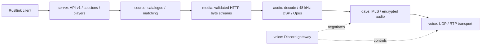

# Rustlink 的獨立 Rust 架構

Rustlink 的服務、客戶端、音源解析、播放器、DSP 與 Discord 協定由本 workspace 的 Rust crates 實作。執行時不啟動 NodeLink、Lavalink、Golalink／GoLink，也沒有透過這些服務轉送播放請求的相容層。FFmpeg 與系統 libopus 保留為成熟的音訊工具；此架構不宣稱每一項第三方函式庫都是 Rust。

## 元件責任

| 元件 | 邊界 |
| --- | --- |
| `protocol`、`client` | 自訂 `/api/v1`、snake_case JSON 與 `rlt1.` 曲目 token。客戶端直接呼叫本服務，不使用其他音訊伺服器的客戶端協定。 |
| `source::Service` | 音源選擇、快取、並行解析、播放時取得新媒體 URL。Spotify／Deezer 提供 metadata，歌曲匹配由 Rust 執行。 |
| `source::media` | 從原本的 `source::lib` 分離。專責 HTTP 回應、range／長度驗證、連續讀取、重試與強 ETag 的 `If-Range`。公共 `Service::open_seekable` 與 `MediaBody` 介面保留。 |
| `source::probe` | 以 Rust 解析容器 metadata；資料不足時保留未知時長，不以 Ogg 的前幾頁冒充整首歌曲長度。 |
| `audio` | Symphonia／原生 Ogg 解碼、重採樣、濾鏡、Opus；不支援的格式可交給 FFmpeg。 |
| `server` | 播放器世代、暫停／換曲順序、工作階段與事件。暫停的 speaking 更新與換曲由相同狀態鎖排序。 |
| `voice`、`dave` | Discord 公開 voice gateway v8 與 DAVE v1；OpenMLS／RustCrypto 提供密碼學。`davey` 只作為測試互通端。 |
| `crates/node` | Rust 執行檔入口、設定與生命週期；此處 node 指服務節點，沒有 Node.js 程式或執行器。 |

## HTTP 資料完整性

每個 206 回應必須提供有效的起始／結束位置與已知總長；Content-Length 必須與該片段一致。chunked transfer 也會逐次檢查實際讀取界限，越界位元組不交給音訊解碼器。未知長度的完整 200 回應仍可作為 live stream；未知總長的 206 回應會明確拒絕。

首次回應若有強 ETag，後續請求會送出 `If-Range`，並拒絕明確不同的 ETag。弱 ETag 與未確認強度的 Last-Modified 不用來宣稱位元組身份相同；沒有強 ETag 的來源只能核對 offset、片段長度與總長，無法保證同大小內容沒有被上游替換。

ureq 的依賴設定集中在 workspace，停用自動 HTTP gzip 解壓，並明確要求 `Accept-Encoding: identity`。這是因為自動解壓會先移除 Content-Encoding／Content-Length，讓媒體的 HTTP 位移與解碼位元組失去可驗證關係。這不影響下載 ZIP／tar.gz 工具封裝的解壓；JSON／歌詞請求改用未壓縮 HTTP 回應，可能增加少量傳輸量。未遵守 identity 的媒體來源會被拒絕。

## 驗證與來源歸屬

API 整合測試確認 `/v3/info`、`/v4/info`、`/v4/loadtracks`、`/loadtracks` 回 404；曲目 codec 測試拒絕舊格式二進位 token。來源與音訊以本機 HTTP、真實 FFmpeg，以及公開 YouTube 音訊驗證；完整結果見 [審查記錄](optimization-audit.md)。

`NOTICE` 記錄早期對 Golalink 行為與設計的參考，屬歷史歸屬，並非執行期依賴。保留該聲明與第三方授權，不把更名或移除聲明當作實作獨立性的證據。
