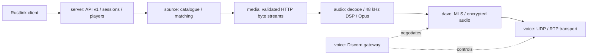

# 架構

服務、客戶端、音源解析、播放器、DSP 與 Discord 協定都由本 workspace 的 Rust crates 實作。執行時不啟動 NodeLink、Lavalink、GoLink，也沒有透過它們轉送播放請求的相容層。FFmpeg 與系統 libopus 保留為成熟的音訊工具；這份架構不宣稱每個第三方函式庫都是 Rust。

## 元件

| 元件 | 邊界 |
| --- | --- |
| `protocol`、`client` | 自訂的 `/api/v1`、snake_case JSON 與 `rlt1.` 曲目 token；客戶端直接呼叫本服務 |
| `source::Service` | 音源選擇、快取、並行解析，以及播放時取得新的媒體網址；Spotify／Deezer 只提供中繼資料，歌曲比對在 Rust 內進行 |
| `source::innertube` | YouTube 用戶端定義與 player 請求；依序嘗試用戶端，換下一個之前保留各自的 User-Agent |
| `source::media` | HTTP 回應、範圍與長度驗證、連續讀取、重試與強 ETag 的 `If-Range`；公開的 `Service::open_seekable` 與 `MediaBody` 介面 |
| `source::netguard` | 所有對外請求的 HTTP 客戶端：不跟隨 redirect、拒絕私有位址、可選的 YouTube 代理 |
| `source::probe` | 以 Rust 解析容器中繼資料；資料不足時保留未知時長，不拿 Ogg 前幾頁冒充整首長度 |
| `audio` | Symphonia 與原生 Ogg 解碼、重採樣、濾鏡、Opus；不支援的格式交給 FFmpeg |
| `server` | 播放器世代、暫停與換曲順序、工作階段與事件；暫停的 speaking 更新與換曲由同一把狀態鎖排序 |
| `voice`、`dave` | Discord 公開的 voice gateway v8 與 DAVE v1；OpenMLS 與 RustCrypto 提供密碼學，`davey` 只作測試對端 |
| `discord-bot` | 主 Gateway、REST、斜線指令與語音事件配對（見[原生機器人](native-bot.md)） |
| `crates/node` | 執行檔入口、設定與生命週期；這裡的 node 指服務節點，與 Node.js 無關 |

## HTTP 資料完整性

每個 206 回應必須帶有效的起訖位置與已知的總長，`Content-Length` 必須與該片段一致。chunked 傳輸也會逐次檢查實際讀取的界限，越界的位元組不會交給解碼器。總長未知的完整 200 回應仍可當直播串流；總長未知的 206 回應會被明確拒絕。

第一次回應若有強 ETag，之後的請求會送 `If-Range`，並拒絕明確不同的 ETag。弱 ETag 與強度不明的 Last-Modified 不用來宣稱位元組相同；沒有強 ETag 的來源只能核對位移、片段長度與總長，無法保證同大小的內容沒有被上游替換。

`ureq` 的相依設定集中在 workspace，停用自動 HTTP gzip 解壓，並明確要求 `Accept-Encoding: identity`：自動解壓會先拿掉 Content-Encoding 與 Content-Length，使媒體的 HTTP 位移與解碼後的位元組失去可驗證的關係。這不影響下載 ZIP／tar.gz 工具封裝的解壓；JSON 與歌詞請求因此改用未壓縮的回應，可能多一點傳輸量。不遵守 identity 的媒體來源會被拒絕。

## 驗證與來源歸屬

API 整合測試確認 `/v3/info`、`/v4/info`、`/v4/loadtracks`、`/loadtracks` 回 404；曲目 codec 測試拒絕舊格式的二進位 token。`NOTICE` 記錄早期對 Golalink 行為與設計的參考，那是歷史歸屬，不是執行期依賴。保留該聲明與第三方授權，不把更名或移除聲明當作實作獨立的證據。
