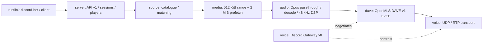

# 系統架構

服務、客戶端、音源解析、播放器、DSP 與 Discord 語音協定皆由本工作區的 Rust Crates 原生實作，執行期不啟動 NodeLink、Lavalink、GoLink 或 `yt-dlp`；系統 `libopus` 與選配 FFmpeg 則作為成熟的編解碼元件。

## 元件職責

| 元件 | 邊界與職責 |
| --- | --- |
| `protocol`、`client` | `/api/v1` `snake_case` 型別、三態 `Patch<T>`、`rlt1.` 曲目權杖與非同步 SDK |
| `source::Service` | 音源路由、`Singleflight` 合併查詢、`Arc<LoadResult>` 快取、預解析串流快取與 Spotify／Deezer 比對 |
| `source::innertube` | 原生 YouTube InnerTube 多用戶端健康度自適應備援與匿名 `visitorData` 引導 |
| `source::media` | 512 KiB 有界區間讀取、2 MiB 背景預讀（`PrefetchReader`）、`Content-Range` 與強 `ETag` `If-Range` 校驗 |
| `source::netguard` | 對外 HTTP 防護：禁止自動轉址繞過、拒絕私有／特殊用途 IP（SSRF 防護）與獨立 `youtubeProxy` |
| `source::probe` | 純 Rust 容器中繼資料探測；資料不足時保留未知時長，不以 Ogg 前幾頁推算全長 |
| `audio` | 48 kHz Opus 零轉碼直通、壓縮封包快轉、Symphonia + 原生 Opus 解碼、32-tap Sinc 重取樣、SIMD DSP 與 FFmpeg 後備 |
| `server` | 播放器世代管理、20 ms 高精度排程執行緒、工作階段續傳、權杖桶限流與 Webhook |
| `voice`、`dave` | Discord Voice Gateway v8、UDP 探索、OpenMLS DAVE v1 E2EE 與 AES-256-GCM / XChaCha20 RTP |
| `discord-bot` | Discord 主 Gateway v10、429 退避 REST、斜線指令與語音事件配對（見 [原生機器人](native-bot.md)） |
| `node` | CLI 入口、嚴格設定驗證、輪替日誌與外部工具 SHA-256 校驗管理 |

## HTTP 串流完整性保證

1. **嚴格區間驗證**：每個 `206 Partial Content` 回應必須具備有效起訖位移、已知總長與相符的 `Content-Length`；chunked 傳輸亦逐塊核對邊界，超量位元組絕不進入解碼器。未知總長的 `200` 支援直播串流；未知總長的 `206` 一律拒絕。
2. **強 `ETag` 一致性**：首次回應若含強 `ETag`，後續續傳必帶 `If-Range` 並拒絕不一致的 `ETag`（弱 `ETag` 與 `Last-Modified` 不作為位元組等同保證）。
3. **停用透明壓縮**：工作區統一停用 `ureq` 的自動 gzip 解壓並要求 `Accept-Encoding: identity`，確保 HTTP 位元組位移與媒體容器位移嚴格一對一對應。

## 協定獨立性與歸屬

API 整合測試確保 `/v3/*`、`/v4/*`、`/loadtracks` 回傳 `404`，曲目編解碼器拒絕舊式二進位權杖。`NOTICE` 保留早期設計參考與第三方開源授權聲明。
