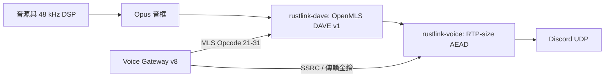

# DAVE 與語音加密

機器人僅需透過 API v1 提供 `voice.token`、`endpoint`、`session_id` 與必填的 `channel_id`，後續 Discord Voice Gateway v8 握手、DAVE v1 端對端加密與 RTP 傳輸皆由 Rustlink 自動完成：

## 協定與密碼學邊界

- **OpenMLS DAVE v1**：`rustlink-dave` 實作 `MLS_128_DHKEMP256_AES128GCM_SHA256_P256`（身分與群組 ID 分別為 8-byte big-endian `user_id` 與 `channel_id`），嚴格驗證外部發送者（Opcode 25）之 Add／Remove 提案、Commit 與 Welcome。
- **零提前降級（Fail-Closed）**：收到 Opcode 25 後才送出裸 `KeyPackage`（Opcode 26）；Commit／Welcome 待 Execute Transition（或 `transition_id == 0`）才切換發送金鑰。僅在 Discord 明確協商協定版本 `0` 時使用純傳輸加密，版本 `1` 尚未備妥金鑰前絕不送出明文音訊。
- **雙層零配置封裝**：內層 Opus 音框以 AES-128-GCM（8-byte tag + ULEB128 nonce + `0xFAFA` 標記）原地加密，每 $2^{24}$ 音框推進金鑰棘輪；外層採 `aead_aes256_gcm_rtpsize` 或 `aead_xchacha20_poly1305_rtpsize` 認證 RTP 標頭，32-bit nonce 耗盡即主動斷線要求重建。
- **單人頻道自舉**：當語音頻道內僅有機器人自身時，Discord 不會下發 Commit／Welcome；節點於收到外部發送者 3 秒後若確認成員僅自己且無待決轉換，即啟用自身 MLS 群組金鑰加密發送，待真人加入後無縫銜接標準 Add／Welcome 換鑰。

## 連線可靠性與驗證

- **心跳與佇列排序**：依 Hello 的 `heartbeat_interval`（支援小數毫秒）排程 `seq_ack` 心跳，未獲 ACK 即斷線；`Speaking(true)` 與 Opus 音框共用單一有界佇列，確保發聲指令必先於首個音框送達。
- **錯誤恢復**：UDP 探索上限 5 秒、完整握手上限 30 秒；遇無效 Commit／Welcome 自動回報並重產 KeyPackage（連續 3 次失敗則關閉連線）。語音斷線不走 Opcode 7 Resume，一律由機器人重送 `set_voice` 建立全新金鑰與 nonce 空間。
- **測試覆蓋**：以獨立 Rust DAVE 實作 `davey` 與本機 Voice Gateway v8／UDP 模擬器離線驗證雙層加解密、成員增減、竄改重播攔截與單人頻道自舉（`cargo test -p rustlink-dave -p rustlink-voice`），並經真實 Discord 語音頻道完整播放實測。
