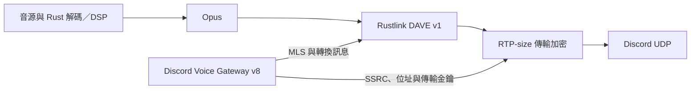

# Rustlink 語音與 DAVE

Rustlink 0.5.0 使用自有 Rust 語音流程；機器人只需經 API v1 提供 voice token、endpoint、session ID 與 channel ID。音訊路徑如下：



## 協定與金鑰

- `rustlink-dave`：自行實作 DAVE 狀態機、gateway opcode 21–31 處理、Opus frame footer 與 sender ratchet；MLS 使用 OpenMLS，AES-GCM、HMAC、SHA-256 使用 RustCrypto。
- DAVE v1：MLS 1.0，`MLS_128_DHKEMP256_AES128GCM_SHA256_P256`。身分是 user ID 的 8-byte big-endian 值，group ID 是 channel ID 的同種表示。
- 僅處理受信任外部 sender 的 Add／Remove 提案；驗證成員名單、重複身分、提案參照、初始 commit、welcome 群組與外部 sender。
- Commit／Welcome 先更新待切換的金鑰；收到 Execute Transition 才切換傳送金鑰。轉換 ID 0 依協定立即生效。一般轉換期間沿用目前的 sender，避免提前換金鑰。
- Opus frame 使用 AES-128-GCM、8-byte tag、ULEB128 nonce 與 `FA FA` 標記。每 2²⁴ frames 換下一代金鑰，nonce 溢位後仍繼續前進，不重複使用 key／nonce。
- 外層使用 `aead_aes256_gcm_rtpsize`，或 `aead_xchacha20poly1305_rtpsize`。RTP header 經認證；32-bit 傳輸 nonce 用盡時關閉連線，要求重新建立。

Discord 仍可能選擇協定版本 0。這時音訊使用傳輸加密；只有 Discord 明確協商版本 0 或執行降級轉換時才會採用。版本 1 沒有金鑰時禁止送出音訊。Rustlink 是音訊傳送服務，不提供語音錄音、影片、使用者裝置持久身分或人工指紋驗證介面。

## 連線與失敗處理

Voice gateway 使用 v8 的 `seq_ack` 心跳及二進位 sequence；UDP discovery 驗證回覆來源、類型、長度與 SSRC。心跳在整個握手期間持續執行，未收到 ACK 時關閉連線。Speaking 命令與音訊經同一個有界佇列依序處理。

完整握手最多 30 秒，包含 DAVE；IP discovery 最多 5 秒。遇到無法驗證的 Commit／Welcome，回報 Invalid Commit Welcome 並產生全新 key package；連續三次恢復仍未成功時關閉連線。原有 sender 只在等待有效轉換期間保留，初始連線沒有未加密的後備路徑。

語音 WebSocket 中斷後，由機器人重新取得語音資訊並呼叫 `set_voice` 建立新連線。API session 的事件重連是另一個流程。

## 驗證範圍

```sh
cargo test -p rustlink-dave -p rustlink-voice
cargo test --workspace
```

DAVE 測試以 `davey` 作為測試用的另一個 Rust 實作，驗證雙方建立／加入群組與音訊解密、成員新增／移除、換金鑰時序、竄改、重播、無效 welcome 恢復及 nonce 邊界。`davey` 不會進入正式執行檔的依賴。

本機 Discord 模擬測試包含 voice v8 Identify、握手期間心跳、二進位 sequence、UDP discovery、DAVE Welcome／Execute 與實際 UDP 封包的兩層解密。它能驗證程式與協定資料的整合，無法替代真實 Discord 伺服器測試；目前未使用真實 bot／語音憑證驗證。

正式使用時，先以 Rust 機器人取得同一次加入頻道的語音資料，再轉送到 Rustlink；觀察 `voice.connected`、`voice.closed` 及 `track.failed`。官方協定參考：[DAVE](https://daveprotocol.com/)、[Discord voice connections](https://docs.discord.com/developers/topics/voice-connections)。
