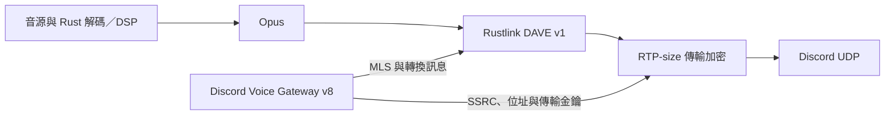

# DAVE 與語音

機器人只需要透過 API v1 提供 voice token、endpoint、session ID 與 channel ID；其餘的 Discord 語音流程由 Rustlink 完成。音訊路徑：



## 協定與金鑰

- `rustlink-dave` 自行實作 DAVE 狀態機、gateway opcode 21–31 的處理、Opus frame footer 與 sender ratchet；MLS 用 OpenMLS，AES-GCM、HMAC、SHA-256 用 RustCrypto。
- DAVE v1 使用 MLS 1.0 與 `MLS_128_DHKEMP256_AES128GCM_SHA256_P256`。身分是 user ID 的 8 位元組 big-endian 值；group ID 是 channel ID 的同種表示，所以 `channel_id` 必填。
- 只處理受信任外部 sender 的 Add／Remove 提案，並驗證成員名單、重複身分、提案參照、初始 commit、welcome 的群組與外部 sender。
- Commit／Welcome 先更新待切換的金鑰，收到 Execute Transition 才切換傳送金鑰；轉換 ID 0 依協定立即生效。一般轉換期間沿用目前的 sender，避免提前換金鑰。
- Opus frame 使用 AES-128-GCM、8 位元組 tag、ULEB128 nonce 與 `FA FA` 標記。每 2²⁴ 個 frame 換下一代金鑰，nonce 溢位後仍繼續前進，不重複使用 key／nonce。
- 外層使用 `aead_aes256_gcm_rtpsize` 或 `aead_xchacha20_poly1305_rtpsize`。RTP header 受認證；32 位元傳輸 nonce 用盡時關閉連線，要求重新建立。
- key package（opcode 26）是不帶 MLSMessage 外層的 `KeyPackage`，且要等收到外部 sender（opcode 25）之後才送：Discord 的語音伺服器會忽略比 opcode 25 早到的 key package。

Discord 可能協商版本 0；這時只用傳輸加密。只有 Discord 明確協商版本 0 或執行降級轉換時才會這樣，版本 1 沒有金鑰時不會送出任何音訊。Rustlink 只負責傳送音訊，不提供語音錄音、影片、使用者裝置的持久身分或人工指紋驗證。

### 頻道裡只有機器人

照規格的〈Initial Group Creation〉，第一個成員自己建立只有自己的群組，之後要有人加入，語音閘道才會送 commit 與 welcome。因此只有機器人在頻道時，閘道不會再送任何 DAVE 訊息，握手永遠等不到轉換。

Rustlink 的做法：收到外部 sender 後等 3 秒，若名單裡只有自己且還沒有轉換，就用自己群組的金鑰開始傳送（音訊仍然加密，沒有明文後備）。之後有人加入，會照一般流程以 Add 提案、commit 與 welcome 換到雙方共用的新金鑰，舊的單人金鑰不會被對方接受。名單裡有其他成員時不會啟動這條路徑，會繼續等 welcome。

## 連線與失敗處理

- 心跳使用 v8 的 `seq_ack` 與 sequence。JSON 的 `seq` 可省略，有值時必須是 16 位元無號整數；伺服器送來的 DAVE binary 訊息前綴也讀 big-endian `u16`。
- 收到 Hello 後，依其 `heartbeat_interval`（含合法的小數毫秒）排定第一個與之後的心跳，不在 Hello 當下多送一次。每次排定送出前，上一個心跳若仍未被 ACK 就關閉連線；因此遺失 ACK 的偵測時間會隨伺服器給的 interval 增加。
- Speaking 命令與音訊經同一個有界佇列依序處理，第一個 Opus 封包一定排在 `Speaking(true)` 之後。
- UDP discovery 驗證回覆的來源、類型、長度與 SSRC，最多 5 秒；完整握手（含 DAVE）最多 30 秒。
- 遇到無法驗證的 Commit／Welcome 時，回報 Invalid Commit Welcome 並產生全新的 key package；連續三次恢復失敗就關閉連線。原有的 sender 只在等待有效轉換期間保留，初始連線沒有明文後備。
- voice WebSocket 中斷後，由機器人重新取得語音資料並呼叫 `set_voice`。每次都以完整 Identify 建立新的傳輸與金鑰、nonce 空間，不實作 opcode 7 Resume，也不重播伺服器緩衝的事件。API session 的事件重連是另一回事。

## 驗證範圍

```sh
cargo test -p rustlink-dave -p rustlink-voice
cargo test --workspace
```

DAVE 測試用 `davey` 當獨立的另一個 Rust 實作，驗證雙方建立與加入群組、音訊解密、成員新增／移除、換金鑰時序、竄改、重播、無效 welcome 的恢復與 nonce 邊界；`davey` 只用在測試，不會進入正式執行檔。本機 Discord 模擬包含 v8 Identify、握手期間的心跳、二進位 sequence、UDP discovery、DAVE Welcome／Execute，以及實際 UDP 封包的兩層解密。單人頻道的路徑有單元測試，且已在真實 Discord 語音頻道完整播過一首歌（2026-11-22）。

本機模擬可以驗證程式與協定資料的整合，但不能取代真實 Discord 伺服器：頻道限速、丟包恢復與主觀聽感都沒有被驗證。

正式使用時，先由機器人取得同一次加入頻道的語音資料再轉給 Rustlink，並觀察 `voice.connected`、`voice.closed` 與 `track.failed`。官方參考：[DAVE](https://daveprotocol.com/)、[Discord voice connections](https://docs.discord.com/developers/topics/voice-connections)。
